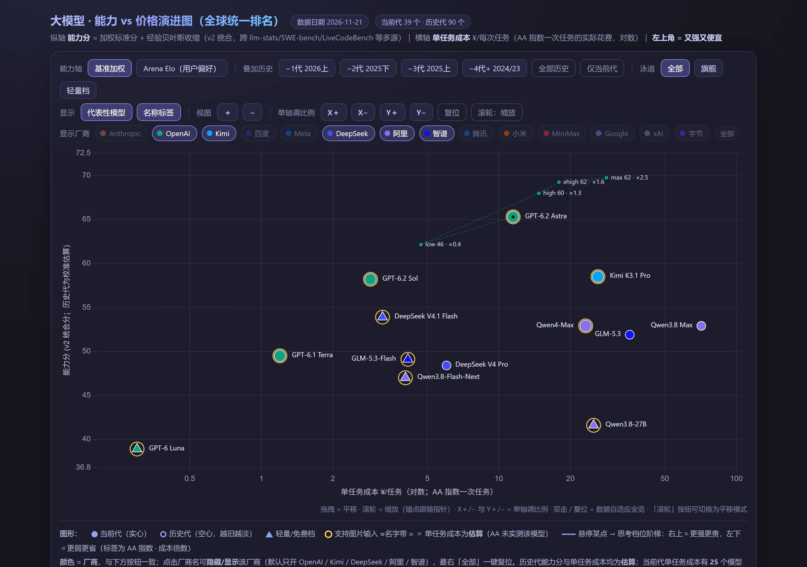

# llm-model-intel

**One table you can actually compare across labs.** Raw scores from six leaderboards, re-expressed on a single scale — with confidence intervals, prices, and subscription-amortised costs. Recomputed daily.

[English](README.en.md) · [中文](README.md)

[](LICENSE)
[](https://www.python.org)
[](master_table_20261121.md)
[](baseline.json)
[](master_table_20261121.md)



<sub>The scatter is a single self-contained HTML file (Chart.js inlined) — open it offline. Shown above: the default view — representative models from 5 vendors (OpenAI / Kimi / DeepSeek / Alibaba / Zhipu), 13 points. Everything else is one click away under 显示厂商.</sub>

---

## What this is

A curated dataset, a recompute pipeline, and two deliverables:

| Component | Role |
|---|---|
| `baseline.json` | Single source of truth: specs, prices, raw leaderboard scores, community signals, source URLs |
| `llm_intel.py` | CLI + SQLite layer: `seed` / `recompute` / `audit` / `q` |
| `generate_master.py` | Emits `master_table_YYYYMMDD.md` |
| `gen_scatter.py` | Emits `scatter_YYYYMMDD.html` (single file, offline) |

14 vendors (9 China-based, 5 overseas), 39 scored models, plus 3 models that are in the library but have no third-party score yet (listed separately, unranked).

## Why not just use the leaderboards

Because their numbers **cannot be subtracted from each other**. llm-stats is TrueSkill (~50 scale), Arena is Elo (~1500), SuperCLUE is percentage, AA is a 0–100 index. Averaging them is meaningless, and reading one board alone conflates *leaderboard coverage* with *capability*.

This library instead: standardises **within** each `(leaderboard, metric)` group, weights by evidence quality, then applies empirical-Bayes shrinkage so thinly-covered models are pulled toward 50 and get wider intervals.

## Scoring (v2)

1. Group by `(leaderboard, metric)` — different effort levels and AutoEval variants never share a z-scale;
2. `z = (v − mean) / sd` per group; single-observation groups are dropped (cannot be localised);
3. Weight `w = conf × overall × src`:
   - `conf`: verified 1.0 / vendor-claimed 0.6 / estimated 0.4
   - `overall`: 1.0 for composite boards, 0.7 for specialised ones
   - `src`: 1.5 for llm-stats (itself an aggregate over 669 benchmarks)
4. `θ = Σwz / (Σw + K)`, `K = 3`; `se = 1/√(Σw+K)`; `CI = θ ± 1.96·se`;
5. `score = 50 + 12·θ`.

> Relative position, not absolute capability. Always quote `n_sources` and the CI alongside the score. A wide interval is honest uncertainty, not a defect.

## The x axis is cost per task, not a price list

The scatter's horizontal axis is **what one task actually costs** (¥ per run), not "price per million tokens". The difference is large: on the same task, a model running at max thinking can burn 30x the tokens of another.

- **25 models are measured** by Artificial Analysis (`intelligenceIndexCostPerTask.cost.total`) at the **vendor default effort** — the same configuration the plotted capability score refers to;
- **14 are inferred**. Four of them use a *same-vendor, same-price proxy*: a sibling sold at an identical input/output price is almost always the same architecture family (Fable 5 / 5.1, DeepSeek 4-flash / 4.1-flash, MiMo 2.5 / 2.6, Grok 4.6 / 4.7), so it inherits the measured value;
- the remaining ten use a **calibrated token profile**: `(300k × p_in + 90k × p_out) × k`, with `k` chosen so the median inferred/measured ratio is exactly 1.0;
- inferred points carry a **`≈` before the name** and show `≈¥` in the tooltip. History rows have no contemporaneous measurement and are all inferred from their output price.

**Why the inference cannot be trusted for fine judgements**: measured cost ÷ output price spans roughly **50x** across the 25 measured models (Terra costs ¥1.2 per task while Gemini 3.8 Flash, at a similar list price, costs ¥44). Token burn is only loosely related to price, so the estimate gives an order of magnitude, not a 10% ranking.

## Two price columns — do not compare across them

Since 2026-11-21 overseas models are priced on a **subscription-quota** basis:

```
plan-equivalent = API list price × k        k = monthly fee ÷ monthly API-equivalent quota
```

| Vendor | Plan | Fee | Monthly API-equivalent quota | k = break-even utilisation |
|---|---|---|---|---|
| Anthropic | Claude Max 20x | $200 | ≈$8,060 | **2.5%** |
| OpenAI | ChatGPT Pro 200 | $200 | ≈$3,191 | **6.3%** |
| Google | AI Ultra 20x | $199.99 | ≈$3,440 | **5.8%** |

`k` is also the break-even utilisation: at `u` of quota consumed the effective price is `list × k/u`, so the plan only wins once `u > k`. Use 30% of your quota and every number above triples.

**This is not evidence that Claude is cheaper than GLM.** The master table therefore keeps two columns (subscription-amortised | API list) with a warning in the header, and the scatter axis stays on API list price to avoid mixing bases.

## Reasoning-effort ladders (on hover)

Hover a point and a **diagonal ladder** unfolds from it: stronger efforts sit **up and to the right** (more capable *and* more expensive), weaker efforts sit **down and to the left** (cheaper, less capable).

- data comes from each model's page on Artificial Analysis: its Intelligence Index split by reasoning effort, plus the **cost of finishing one index task** at that effort;
- **the anchor is the vendor's default effort** (AA `release.defaultEffort`). The plotted point is the configuration the list price actually buys, so the ladder opens **both up and down**, not only downward;
- **the horizontal offset is measured, not drawn**: since the x axis already is cost per task, each rung sits at its own cost (anchor cost × that tier's cost ratio from AA `intelligenceIndexCostPerTask`). More thinking means more reasoning tokens, which is why higher efforts drift right;
- **vertical offset** is the AA index delta, scaled. It is **not** mapped onto the plot's y axis: Opus spans 24 index points from low to max while the whole axis spans ~40, so a true-scale ladder would leave the frame. The ladder is therefore a **local inset** attached to the point, and every rung is labelled with the real numbers (AA index · cost multiplier, anchor = 1.0);
- **only models where AA publishes more than one effort get a ladder** (11 of 39 today). Kimi, Qwen4, MiniMax and MiMo expose a single effort on AA, so hovering them shows nothing. GLM-5.3's default *is* its top effort (max), so it only has the downward half; both DeepSeek models default to high, so they only have the upward half. That is vendor configuration, not missing data.

## Quick start

```bash
python llm_intel.py init        # create tables (idempotent)
python llm_intel.py seed        # baseline.json -> llm_intel.db
python llm_intel.py recompute   # recompute composite scores
python llm_intel.py audit       # read-only DB <-> baseline reconciliation (must be 0 ERROR)
python generate_master.py       # -> master_table_YYYYMMDD.md
python gen_scatter.py           # -> scatter_YYYYMMDD.html
```

Standard library only, Python 3.13. `llm_intel.db` is a build artefact and is gitignored — rebuild it with `init` + `seed`.

## Data sources

| Source | Used for | Weight |
|---|---|---|
| [llm-stats.com](https://llm-stats.com/leaderboards/llm-leaderboard) full board | four TrueSkill dimensions | ×1.5 |
| [vals.ai](https://www.vals.ai/benchmarks/swebench) | independent SWE-bench Verified | ×1.0 |
| Vendor pricing pages / docs | price, context, licence | — |
| Bilibili / community tests | qualitative signals only | **not scored** |

Community signals are used to spot gaps and to widen intervals — never to move a score directly.

## Known limits

- **Coverage bias**: a model with 2 sources is shrunk hard (CI often ±10). Do not read small score gaps between differently-covered models as capability gaps.
- **Re-anchoring**: adding one tail model shifts every score (a new low-scoring entry lifts the whole top by ~0.3). That is a distribution effect, not progress.
- **AA index is stale**: the library still carries v4.2 while AA ships v5.
- **Subscription conversion relies on third-party measurement**: the quota figures come from community logging at API list prices, not from vendor documentation.

## Licence

[MIT](LICENSE). Prices and scores belong to their respective sources; this repo only aggregates and recomputes them.
