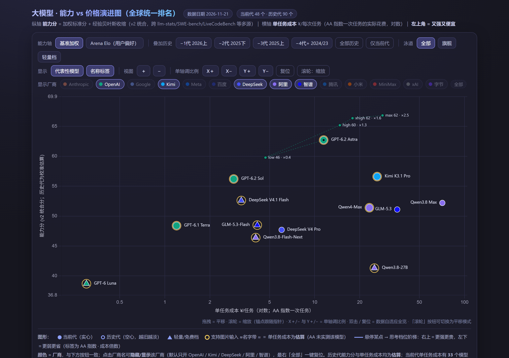

# 大模型情报库 · llm-model-intel

**一张能横着比的模型总表。** 把各家散落的原始分转成同一把尺子，附置信区间、价格与订阅折算，每天重算一次。

[English](README.en.md) · [中文](README.md)

[](LICENSE)
[](https://www.python.org)
[](master_table_20261121.md)
[](baseline.json)
[](master_table_20261121.md)
[](CONTRIBUTING.md)



<sub>散点图是自包含单文件（Chart.js 已内联），双击即可离线打开；上图是默认视图：代表性模型 × 5 家厂商（OpenAI / Kimi / DeepSeek / 阿里 / 智谱），13 个点。其余厂商在「显示厂商」里一键打开。</sub>

---

## 这是什么

一份**策展数据集 + 一条重算流水线 + 两个交付物**：

| 组件 | 说明 |
|---|---|
| `baseline.json` | 唯一事实源。模型规格、价格、榜单原始分、社区信号、信源 URL 全在这里 |
| `llm_intel.py` | CLI + SQLite 层：`seed` / `recompute` / `audit` / `q` |
| `generate_master.py` | 生成权威总表 `master_table_YYYYMMDD.md` |
| `gen_scatter.py` | 生成能力-价格散点图 `scatter_YYYYMMDD.html`（单文件、可离线） |

覆盖 **14 家厂商**（境内 9：智谱 / 阿里 / 腾讯 / DeepSeek / 月之暗面 / 字节 / 小米 / 百度 / MiniMax；境外 5：Anthropic / OpenAI / xAI / Google / Meta），当前 **48 个评分模型**，另有 3 个「已入库无第三方分」的待评级项。

## 为什么不用现成榜单

因为现成榜单**彼此不能相减**。llm-stats 是 TrueSkill（≈50 分制）、Arena 是 Elo（≈1500）、SuperCLUE 是百分制、AA 是 0–100 指数——把它们的数字平均起来毫无意义，而只看单个榜又会把「榜单覆盖度」误读成「能力强弱」。

这张表做的是：**同一榜内先转 z 标准分（保留差距大小，不只排名），再按可信度加权，最后用经验贝叶斯收缩**，让覆盖度低的模型自动向 50 靠拢并拿到更宽的 CI。

## 评分方法（v2）

1. 取所有榜单行，按 **`(leaderboard, metric)`** 分组 —— `elo_webdev` / `elo_webdev_max` / `autoeval` 各自成组，口径不同绝不共享 z 尺度；
2. 组内 `z = (v − mean) / sd`；单样本组无法定位，直接跳过；
3. 每条 z 加权 `w = conf_w × overall_w × src_w`：
   - `conf_w`：`verified` 1.0 / `vendor_claimed` 0.6 / `estimated` 0.4
   - `overall_w`：综合榜 1.0 / 专项榜 0.7
   - `src_w`：llm-stats（聚合 669 个基准）1.5
4. 经验贝叶斯收缩 `θ = Σwz / (Σw + K)`，`K = 3`；`se = 1/√(Σw+K)`，`CI = θ ± 1.96·se`；
5. 展示分 `score = 50 + 12·θ`。

> **结果只表示相对位次，不是绝对能力。** 报分必须同时报 `n_sources` 与 CI。宽区间是诚实的不确定，不是 bug。

## 横轴：单任务成本，不是价目表

散点图的横轴是**完成一次任务的实际花费**（¥/每次），不是「每百万 token 多少钱」。差别很大：同样的任务，一个把 thinking 开到最大的模型能烧掉另一个模型 30 倍的 token。

- **33 个模型是 AA 实测**：`artificialAnalysis.ai` 的 `intelligenceIndexCostPerTask.cost.total`，取**厂商默认档**那一行（与你在图里看到的能力分同一档配置）；
- **14 个是推算**，其中 4 个用「同厂同价代理」——同一厂商、输入输出价完全相同的兄弟型号通常就是同一代架构（Fable 5 / 5.1、DeepSeek 4-flash / 4.1-flash、MiMo 2.5 / 2.6、Grok 4.6 / 4.7），直接继承实测值；
- 剩下 10 个用**校准过的 token 画像**推算：`(300k × 输入价 + 90k × 输出价) × k`，`k` 取到「推算值 ÷ 实测值」的中位数为 1.0；
- 推算点在**名字前带 `≈`**，tooltip 里也会写 `≈¥`。历史代没有当年实测，全部按同一画像从其输出价推算。

**为什么推算不能当真**：实测成本 ÷ 输出价 在我们测过的 25 个模型里跨度约 **50 倍**（Terra 每任务 ¥1.2，Gemini 3.8 Flash 同价位却要 ¥44）。也就是说「花多少 token」这件事跟价格几乎无关——推算只能给出量级，不能拿来判 10% 的性价比差。

## 两个价格列，别横着比

2026-11-21 起，境外模型的定价基准从「API 挂牌价」改为「**订阅额度折算**」：

```
折算价 = API 挂牌价 × k        k = 订阅月费 ÷ 满额度月 API 等值
```

| 厂商 | 档位 | 月费 | 满额度月 API 等值 | k ＝ 回本临界使用率 |
|---|---|---|---|---|
| Anthropic | Claude Max 20x | $200 | ≈$8,060 | **2.5%** |
| OpenAI | ChatGPT Pro 200 | $200 | ≈$3,191 | **6.3%** |
| Google | AI Ultra 20x | $199.99 | ≈$3,440 | **5.8%** |

**k 同时就是回本临界使用率**：额度用掉 `u` 时等效单价 = 挂牌价 × `k/u`，`u > k` 才比按量便宜。额度只用三成，上表数值就要乘 3.3。
**这不代表 Claude 比 GLM 便宜** —— 它是「用满额度」的边际成本。

xAI（只公布套餐倍数、无绝对额度）与 Meta（无消费级订阅）**不折算**，保留 API 价。总表因此有**两个价格列**，表头有红字警示；散点图横轴改用**单任务成本**（见上一节），与这两列都不一样：它把「花多少 token 才办完一件事」也算进去了。

## 思考档位（悬停显示）

鼠标停在某个点上，会从该点拉出一条**斜向阶梯**：越强的档位在**右上**（更强、也更贵），越弱的档位在**左下**（更弱、也更省）。

- 数据来自 Artificial Analysis 各模型页的指数分解：同一模型按 reasoning effort 分档的 Intelligence Index，以及该档**完成一个评测任务的成本**；
- **锚点＝厂商默认档**（AA `release.defaultEffort`）。模型点本身就是你按挂牌价买到的那一档，所以阶梯会**同时向上和向下**展开，而不是只会往下；
- **横移是真实值**：横轴既然已经是单任务成本，每个档位就直接画在它自己的成本上（＝锚点成本 × 该档成本倍数，倍数取自 AA `intelligenceIndexCostPerTask`）。思考档位越高，reasoning token 越多，点就越靠右——这条斜线是量出来的，不是画出来的；
- **纵移**按 AA 指数差值等比缩放。**它不映射到图上纵轴**：Opus 的 low↔max 差 24 分，而整条纵轴只有 ~40 分，画在真坐标上会直接出框。所以阶梯是挂在点上的**局部小图**，每个档位都用标签写出真实数字（AA 指数 · 成本倍数，倍数以默认档为 1.0）；
- **只覆盖 AA 确实公布了多档的模型**（当前 19/48）。Kimi、Qwen4、MiniMax、MiMo 等在 AA 只有单档，悬停不会有阶梯；GLM-5.3 的默认档就是它的最高档（max），所以只有向下的一半；两个 DeepSeek 的默认档是 high，所以只有向上的一半——这是厂商配置，不是缺数据。

## 快速开始

```bash
python llm_intel.py init        # 建表（幂等）
python llm_intel.py seed        # baseline.json -> llm_intel.db
python llm_intel.py recompute   # 重算统合分
python llm_intel.py audit       # 只读体检：DB ↔ baseline 对账（0 ERROR 才算过）
python generate_master.py       # -> master_table_YYYYMMDD.md
python gen_scatter.py           # -> scatter_YYYYMMDD.html
```

只依赖标准库，Python 3.13。`llm_intel.db` 是生成物，已 gitignore —— 由 `init` + `seed` 重建。

## 目录

```
llm-model-intel/
├── baseline.json          策展数据集（唯一事实源）
├── llm_intel.py           CLI / DB 层 / 统合分
├── generate_master.py     总表生成器
├── gen_scatter.py         散点图生成器
├── scatter_tpl.html       散点图模板（样式只改这里）
├── history.json           历史代模型（跨代对比用）
├── effort_tiers.json      思考档位阶梯（AA 指数，悬停显示用）
├── chart.umd.min.js       Chart.js 4.4.1（内联，离线可用）
├── master_table_20261121.md
└── scatter_20261121.html
```

## 数据来源

| 来源 | 用途 | 权重 |
|---|---|---|
| [llm-stats.com](https://llm-stats.com/leaderboards/llm-leaderboard) 全量榜 | 四维 TrueSkill（Overall / Reasoning / Coding / Agent） | ×1.5 |
| [vals.ai](https://www.vals.ai/benchmarks/swebench) | SWE-bench Verified 独立复现 | ×1.0 |
| 厂商官方价目 / 文档 | 价格、上下文、许可 | — |
| B 站 / 社区实测 | 定性口碑，进 `community_signals` | **不入分** |

社区信号只用于补漏与修正置信区间，**绝不直接改能力分**。

## 已知局限

- **覆盖度偏差**：只有 2 个源的模型会被收缩得很厉害（CI 宽到 ±10），别拿它和 10 源模型的分差当结论；
- **相对分 ≠ 绝对能力**：全池重锚定时，所有模型的分都会一起动（加一个尾部模型能让头部涨 0.3），这是分布效应不是能力变化；
- **AA 智能指数版本滞后**：库内仍为 v4.2，官方已到 v5，待整组替换；
- **订阅折算依赖第三方实测**：Anthropic / OpenAI 的额度是社区日志计价测出来的，不是官方数字。

## 更新节奏

每日 09:00 自动跑一次（周一 / 三 / 五 / 日）：扫厂商公告 → 抓 llm-stats 全量榜 → 重算 → 出总表与散点图。能力分变动 > 3、标准输出价变动 > 10%、或模型增删，才推送简报，否则静默。

## 许可

[MIT](LICENSE)。数据部分（价格、分数）版权归各自来源，本仓库只做聚合与重算。
